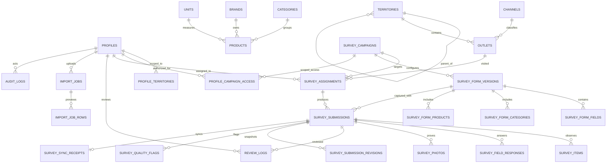

# Database ERD — Admin Control Center

All master data is deactivated rather than deleted when referenced. Form versions retain their own field/category/product configuration; published versions cannot be edited, and submissions retain the version used at capture. Imports use separate job types for outlet masters and campaign assignments, and each row keeps preview results and prior values needed for a guarded rollback. Admin metrics are derived from RLS-filtered database counts; there are no hardcoded metric values.

The hierarchy and pilot seed use synthetic records only. Region/depo/kecamatan/kelurahan remain a parent-child territory tree; outlet assignment imports and outlet-master imports are separate jobs. `survey_submission_revisions` snapshots each resubmission so corrections retain the previous raw observation. `survey_sync_receipts` record successful server receipt only; unsynchronized device outboxes are not visible to the server.
